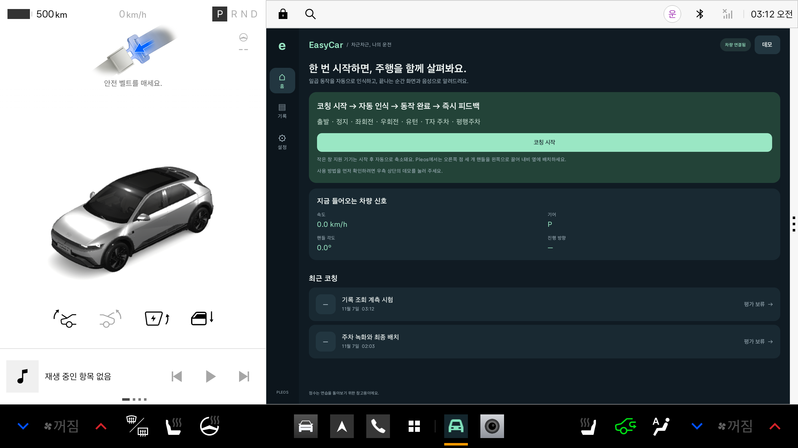
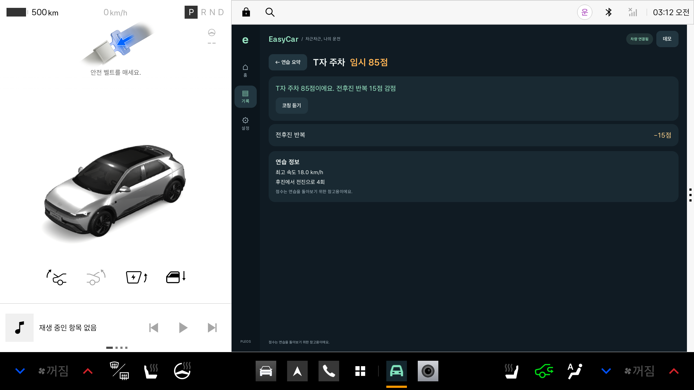
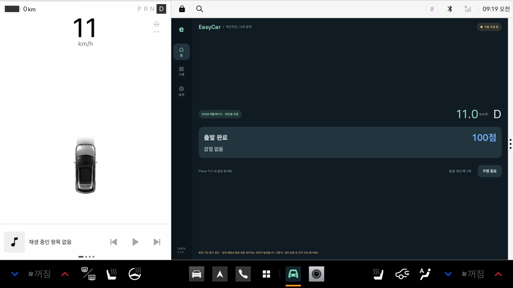
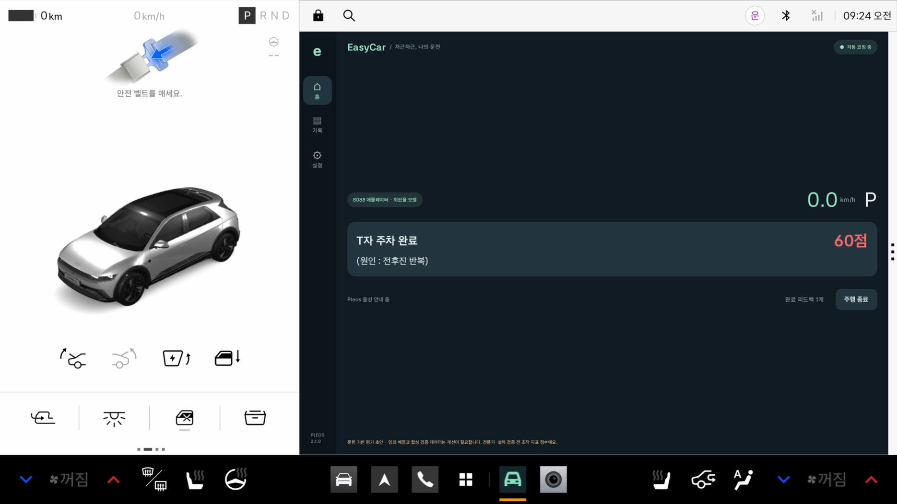
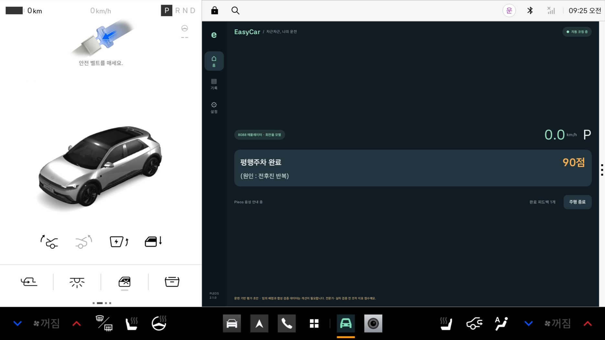
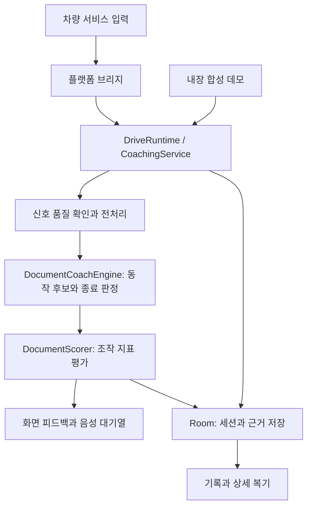

# Hyundai Pleos App EasyCar

**차량 신호로 동작을 관측하고, 동작이 끝나면 화면과 음성으로 복기하는 Pleos 운전 코칭 앱 'EasyCar'입니다.**

EasyCar는 출발·정지·회전·주차 연습을 돌아볼 수 있도록 만든 Kotlin / Jetpack Compose 기반 Android 앱입니다. 사용자가 매번 동작을 선택하지 않아도, 코칭을 시작하면 차량 신호에서 동작 후보를 찾고 관측한 조작에 대한 점수와 감점 원인을 안내합니다.

| 항목 | 내용 |
| --- | --- |
| 프로젝트명 | Hyundai Pleos App EasyCar |
| GitHub 저장소 | [euunhwa/DriveCoach](https://github.com/euunhwa/DriveCoach) |
| 앱 이름 / 현재 버전 | EasyCar / `0.13.2` (`versionCode 18`) |
| 대상 환경 | Pleos Connect `v2.1.0` 에뮬레이터 기준 개발·검증 |
| 구현 방식 | 차량 신호 기반 규칙 인식 + 문헌 기반 평가 초안 + 한국어 화면·음성 피드백 |
| 현재 단계 | 에뮬레이터에서 기능을 검증한 시제품 |
| 문서 기준일 | 2026-11-08 |

> 현재 점수는 **관측된 조작 지표에 대한 임시 점수**입니다. 평가 배점과 합성 검증 데이터는 전문가·실차 검증과 개선이 필요합니다. 100점이 도로 안전성이나 주차 성공을 보증하지 않습니다.

## 목차

- [1. 프로젝트 소개](#1-프로젝트-소개)
- [2. 주요 기능](#2-주요-기능)
- [3. 실제 화면과 시연 결과](#3-실제-화면과-시연-결과)
- [4. 입력 모드와 지원 범위](#4-입력-모드와-지원-범위)
- [5. 동작 인식과 점수 계산](#5-동작-인식과-점수-계산)
- [6. 기술 스택과 구조](#6-기술-스택과-구조)
- [7. 개발 환경과 빌드](#7-개발-환경과-빌드)
- [8. 설치와 실행](#8-설치와-실행)
- [9. 테스트와 검증 근거](#9-테스트와-검증-근거)
- [10. 데이터와 기록 관리 — 인식·평가 출처와 검증 자료](#10-데이터와-기록-관리)
- [11. 협업 방법](#11-협업-방법)
- [12. 현재 한계와 후속 개발](#12-현재-한계와-후속-개발)
- [13. 상세 문서](#13-상세-문서)
- [14. 새 저장소 제출용 파일](#14-새-저장소-제출용-파일)

## 1. 프로젝트 소개

운전 연습에서는 동작을 마친 뒤 어떤 조작을 바꾸면 좋을지 구체적으로 돌아보는 과정이 필요합니다. EasyCar는 차량에서 관측한 속도·기어·핸들 각도 등의 신호를 동작 단위로 묶고, 가감속 변화나 전후진 반복처럼 설명할 수 있는 근거를 코칭으로 연결합니다.

목표 사용자는 운전과 주차를 연습하고 자신의 조작을 복기하려는 운전자입니다. 코칭 중에는 짧은 안내를 제공하고, 정차 후에는 기록에서 동작별 점수와 감점 이유를 쉬운 설명으로 확인하는 흐름을 지향합니다.

1. 정차 상태에서 시작 안내에 동의하고 차량 연결을 확인합니다.
2. 홈에서 **코칭 시작**을 누릅니다.
3. 앱이 입력 신호에서 동작의 시작과 종료를 관측합니다.
4. 동작 완료 후 점수와 짧은 감점 원인을 화면에 표시하고 음성으로 안내합니다.
5. 완료 카드는 약 5초 후 다음 동작 대기 화면으로 돌아갑니다.
6. 코칭 종료 후 **기록**에서 결과와 평가 근거를 확인합니다.

## 2. 주요 기능

| 기능 | 구현 내용 |
| --- | --- |
| 자동 동작 관측 | 출발·좌회전·우회전·유턴·정지·T자 주차·평행주차의 7개 주요 유형을 규칙으로 판별합니다. 필수 신호와 종료 조건이 충족되어야 결과를 확정합니다. |
| 완료 직후 피드백 | 동작명, 점수 또는 평가 대기 상태, 짧은 감점 원인을 표시합니다. 완료 카드는 약 5초 후 숨기고 기록은 보존합니다. |
| 점수별 음성 안내 | 동작명과 점수를 먼저 읽고, 점수와 감점 원인에 맞는 한국어 문구를 안내합니다. 100점 칭찬은 6개 문장을 섞어 순환합니다. |
| 발화 시점 관리 | 회전·후진 중에는 발화를 보류하고 통화·우선 오디오 등에서는 중단할 수 있습니다. 무음과 최소 안내 간격을 설정할 수 있습니다. |
| 기록과 상세 복기 | 세션별 점수, 쉬운 감점 이유, 평가 보류 안내와 코칭 다시 듣기를 제공합니다. 입력 출처·기준 버전·측정값은 저장 자료에 보존합니다. **저장 기록에 질문하기**에서 최근 동작·감점 이유·이번 연습 요약을 조회하고, 선택한 기록을 Gleo 음성 질문에 연결할 수 있습니다. |
| 반응형 화면 | 홈·기록·설정의 3개 메뉴를 사용합니다. 좁은 분할 창에서는 차량 신호·대기 상태·완료 피드백·종료 동작 중심으로 간결하게 표시합니다. |
| 별도 내장 데모 | 우측 상단 **데모**에서 합성 신호로 7개 동작을 재생합니다. 음성을 켠 데모는 발화 완료를 기다린 뒤 다음 동작으로 진행합니다. |
| 기기 내 보관 | Room으로 연습 기록을 저장하고 DataStore로 사용자 설정을 관리합니다. 개별·전체 삭제와 보관 기간 설정을 지원합니다. |
| 주차 영상 복기 보조 | 흰색·노란색 주차선과 차량 위치를 분석하고 기울어짐·치우침·주차선 침범을 쉬운 말로 안내합니다. 상세 수치는 내부 근거로 보존합니다. 최근 1초의 5개 프레임을 비교해 결과를 저장하며 기존 동작 점수를 보존합니다. 기록 화면에서 합성 영상 예제를 바로 열 수 있습니다. [사용 방법과 검증](docs/parking-video-analysis-ko.md) |

0.13.2부터 홈은 **지금 들어오는 차량 신호·속도·기어·핸들 각도·진행 방향**을 유지하며 개발 설명을 숨깁니다. 코칭·기록 상세·질문·영상 화면과 다시 듣기는 쉬운 표현을 사용하고 내부 코드·버전·전문 단위·JSON 도구를 노출하지 않습니다. **설정의 기술 설명은 사용자 요청대로 유지**하며 인식/평가 규칙과 기존 점수·원본 근거는 변경하지 않습니다.

음성 안내를 기다리는 동안에도 **차량 서비스 입력 수집은 계속됩니다**. 재생 위치를 멈추는 동작은 내장 합성 데모에만 적용됩니다.

## 3. 실제 화면과 시연 결과

### 현재 화면 · 0.13.2

홈은 **속도·기어·핸들 각도·진행 방향**만 간단히 표시하고, 기록 상세는 쉬운 감점 이유로 안내합니다. 상위 메뉴는 **홈·기록·설정**이며 설정의 기술 설명은 유지합니다.

| 홈 | 동작 상세 |
| --- | --- |
|  |  |

현재 화면 색상은 **100점 파랑 / 80~99점 주황 / 0~79점 빨강**입니다. 평가가 보류된 결과는 0점으로 바꾸지 않습니다.

### 과거 8088 시연과 검증 · 0.9.3

아래 캡처와 8개 장면 결과는 0.9.3 당시의 검증 기록입니다. 최신 화면 문구는 위의 0.13.2 캡처를 기준으로 확인합니다. 당시 속도·기어·핸들 각도는 차량 서비스를 통해 수신했고, 회전율(yaw rate)은 DEBUG 에뮬레이터 전용 모델로 계산했습니다.

#### 출발 완료 · 100점



#### 주차 피드백 비교

| T자 주차 · 60점 | 평행주차 · 90점 |
| --- | --- |
|  |  |

0.9.3의 8088 시연은 장면마다 새 코칭 세션을 시작한 8개 장면으로 구성했습니다.

| 순서 | 관측된 동작 | 실제 점수 | 주요 결과 |
| --- | --- | --- | --- |
| 1 | 출발 | 100 | 해당 입력에서 감점 조건 없음 |
| 2 | 좌회전 | 100 | 약 90° 회전 운동 후보 관측 |
| 3 | 우회전 | 100 | 반대 방향 약 90° 회전 운동 후보 관측 |
| 4 | 유턴 | 100 | 약 180° 회전 운동 후보 관측 |
| 5 | 정지 | 100 | 감속 후 정차 종료 조건 확인 |
| 6 | T자 주차 | 60 | R→D 9회, 기본 허용 1회 초과분 8회 × 5점 감점 |
| 7 | 평행주차 | 90 | R→D 4회, 기본 허용 2회 초과분 2회 × 5점 감점 |
| 8 | T자 주차 비교 | 85 | R→D 4회, 기본 허용 1회 초과분 3회 × 5점 감점 |

앱에는 동작 정답이나 고정 점수를 주입하지 않았습니다. 각 세션의 입력 프레임과 계산 결과를 확인했고, 8개 장면 모두 음성 완료 상태 `SPOKEN`을 기록했습니다. 이는 설계한 에뮬레이터 입력의 재현 결과이며 실차 인식 정확도 측정은 아닙니다.

재현 과정과 검증 근거는 [8088 촬영 문서](docs/console-capture-ko.md), [8개 장면의 실제 결과 JSON](docs/validation/console-capture-verified-scenes-20261107.json), [촬영 입력 예제](examples/console-showcase/manifest.json)에서 확인할 수 있습니다.

## 4. 입력 모드와 지원 범위

**빌드 종류**(`pleos` / `demo`)와 **실행 시 입력 선택**(코칭 시작 / 내장 데모)은 별개입니다. `pleos` 빌드에서도 내장 데모를 실행할 수 있습니다.

| 실행 경로 | 입력 출처 | 현재 사용 범위 |
| --- | --- | --- |
| `pleos` 빌드 → 코칭 시작 | AAOS 속도·기어, Pleos 핸들 각도 등 차량 서비스 입력 | 연결·권한·신호 품질을 확인하며 관측합니다. 실차용 브리지에는 검증된 yaw 공급자가 없어 회전·주차 유형 평가를 보류합니다. |
| `pleosDebug` 에뮬레이터 → 코칭 시작 + 8088 조작 | Virtual Console → DDS → 차량 서비스 → 앱 | 속도·기어·핸들은 수신값을 사용하고 yaw만 명시적 모델로 보완해 7개 유형을 시연합니다. |
| 우측 상단 데모 | 앱에 포함된 합성 `auto-drive.json` | 7개 주요 동작과 완료 피드백·음성·기록 흐름을 재현합니다. |
| `demo` 빌드 | 합성 데모 + Android 기기 내 한국어 TTS | Pleos 차량 서비스 없이 UI와 데모를 확인하는 경로입니다. 한국어 오프라인 음성이 없으면 글로 안내합니다. |

### 에뮬레이터 yaw 모델

모델은 `BuildConfig.DEBUG && emulated` 조건에서만 활성화됩니다.

```text
yawRate = signedSpeed / 2.7 × tan((steeringWheelDeg / 15) × π / 180)
```

- 축거 2.7m와 조향비 15는 시연용 가정이며 차종별 실측 보정값이 아닙니다.
- 전진 D는 양의 속도, 후진 R은 음의 속도로 계산합니다.
- 출처를 `EMULATOR_BICYCLE_MODEL_NOT_SENSOR`로 기록합니다. 모델 사용 여부와 의미는 설정·저장 근거·README에서 확인하며, 일반 코칭·기록 화면에는 내부 출처 코드를 표시하지 않습니다.
- 입력 누락·지연·단위 오류가 있으면 모델 yaw도 사용하지 않습니다.
- 실제 기기와 release 빌드에서는 이 모델로 yaw를 보완하지 않습니다.

구현은 [PleosBridge](app/src/pleos/java/com/example/easycar/PleosBridge.kt), [EmulatorDynamics](core/src/main/kotlin/com/easycar/core/EmulatorDynamics.kt), 상세 조건은 [인식 문서](docs/datasets/recognition-ko.md)를 참고합니다.

## 5. 동작 인식과 점수 계산

### 인식 방식

현재 인식기는 **규칙 기반 상태 처리**를 사용합니다. 속도·기어와 유효한 yaw 등으로 동작 후보를 시작하고, 지속 시간과 종료 조건을 확인합니다.

| 동작 | 핵심 판별 조건 요약 |
| --- | --- |
| 출발 | 4초 이상 안정 정차를 확인한 뒤 D에서 0.7m/s 이상 이동 |
| 정지 | 주행·감속을 관측한 뒤 4초 정차로 완료 확인 |
| 좌·우회전 | 유효한 yaw의 지속 구간을 적분해 방향 변화 60~120°와 부호 확인 |
| 유턴 | 같은 회전 구간의 방향 변화 절댓값 150~210° |
| 주차 진입·종료 | 10km/h 이하에서 안정된 R단 진입 후 전후진 누적, P+정차 또는 장기 정차 등으로 종료 확인 |
| T자 주차 후보 | 전진 준비·후진 구간의 방향 변화와 한 방향 조향 패턴 확인 |
| 평행주차 후보 | 작은 최종 방향 변화와 후진 중 양방향 조향·yaw 패턴 확인 |

급출발·급가속·급감속·고속 회전도 별도 조건으로 관측합니다. T자·평행주차는 **차량 운동 패턴 후보**이며 실제 주차 공간과 차체 위치의 완성도를 확정하지 않습니다.

입력은 명목 10Hz로 선택하고 속도·핸들에는 3점 중앙값, yaw에는 후방 200ms 평균을 적용합니다. 역순·중복·오래된 신호나 필수 입력 누락을 처리하며, 부족한 신호를 0 또는 정상값으로 채우지 않습니다. 전체 시작·종료·보류 조건은 [인식용 데이터와 판별 조건](docs/datasets/recognition-ko.md)에 관리합니다.

### 평가 방식

점수는 100점에서 관측된 항목의 감점을 빼는 방식입니다.

```text
동작 점수 = 100 − min(100,
    가감속 그룹 감점 + jerk 감점 + 회전 그룹 감점
    + 주차 전후진 횟수 감점 + 주차 시간 감점)
```

| 항목 | 현재 초안 기준 |
| --- | --- |
| 가속 | 2m/s² 초과부터 주의 5점, 10/3.6m/s² 이상 위험 7점. 연속 600ms 조건 적용 |
| 감속 절댓값 | 2m/s² 초과부터 주의 5점, 3.5m/s² 초과 위험 7점. 연속 600ms 조건 적용 |
| 종방향 jerk 절댓값 | 0.9m/s³ 초과부터 주의 5점, 1.5m/s³ 초과 위험 7점. 연속 600ms 조건 적용 |
| 회전 횡가속 | 피크 0.25g 초과 주의 5점, 0.4g 초과 위험 7점. 전용 센서가 없으면 유효한 `속도 × yaw`로 추정 |
| 고속 회전 | 인식 조건에 해당하면 7점. 횡가속 감점과 큰 값 하나만 적용 |
| 주차 전후진 | 안정된 R→D를 계산합니다. T자 1회·평행 2회를 넘으면 초과 회당 5점 |
| 주차 시간 | 120초 이내 감점 없음. 이후 초과한 120초 블록마다 10점 |

가속·감속은 같은 동작에서 큰 감점 하나만 적용하고, 횡가속·고속 회전도 큰 감점 하나만 적용합니다. 예를 들어 가속과 jerk에서 각각 5점이 발생하면 90점입니다.

필수 신호의 충족률이나 동작 근거가 부족하면 점수를 `null`로 보류하고 이유를 저장합니다. 세션 점수는 **모든 동작이 평가되었을 때 동작 점수의 산술평균을 정수로 표시**하며, 보류 동작이 있으면 세션 점수도 보류합니다.

배점은 문헌·추론에서 출발한 앱 설계 초안입니다. 실행 수식, 경계값, 적용하지 않은 항목은 [평가용 데이터와 채점 기준](docs/datasets/evaluation-ko.md), 실제 계산은 [DocumentScorer](core/src/main/kotlin/com/easycar/core/DocumentScorer.kt)를 참고합니다.

## 6. 기술 스택과 구조

| 영역 | 기술 / 설정 |
| --- | --- |
| 언어·UI | Kotlin `2.2.10`, Jetpack Compose, Material 3 |
| 실행·상태 | Kotlin Coroutines, Flow, ViewModel, Foreground Service |
| 저장 | Room `2.6.1`, DataStore Preferences `1.1.7`, Gson `2.11.0` |
| 차량 입력 | AAOS `CarPropertyManager`, Pleos Vehicle `2.3.2` |
| 음성 | Pleos TextToSpeech `3.3.1`의 기기 내 모드, demo 빌드의 Android TTS |
| 위치 연결 | Pleos FusedLocation `1.1.3`; 현재 heading은 회전 판별의 대체 신호로 사용하지 않음 |
| 빌드 | Gradle Wrapper `9.6.0`, Android Gradle Plugin `9.5.0`, JDK `17` |
| Android 설정 | `compileSdk 37`, `targetSdk 34`, `minSdk 28` |
| 검사 | JUnit 4, Android 계측 검사, Compose UI 검사 |

### 처리 흐름



### 디렉터리

```text
.
├── app/
│   └── src/
│       ├── main/
│       │   ├── java/com/example/easycar/
│       │   │   ├── data/          # Room 저장소와 사용자 설정
│       │   │   ├── runtime/       # 코칭 서비스, 입력·음성·세션 관리
│       │   │   └── ui/            # 홈·기록·설정, 분할 화면과 피드백
│       │   └── assets/
│       │       ├── datasets/document-v1/  # 활성 인식·평가 설정과 합성 검증 자료
│       │       └── profiles/              # 현재·과거 프로필
│       ├── pleos/                # Pleos 차량 서비스와 TTS 어댑터
│       ├── demo/                 # 차량 서비스 없는 데모용 어댑터
│       ├── test/                 # 앱 JVM 검사
│       └── androidTest/          # 장치·UI·저장·음성·촬영 계측 검사
├── core/
│   └── src/
│       ├── main/kotlin/com/easycar/core/  # 전처리·인식·평가·피드백·합성 예제
│       └── test/kotlin/com/easycar/core/  # 코어 회귀 검사
├── docs/                         # 설계, 기준, 변경 이력, 검증 근거
├── examples/                     # 보정 JSON과 8088 시연 입력
├── tools/                        # 데이터 생성·에뮬레이터 촬영 도구
└── gradle/                       # 버전 카탈로그와 Wrapper
```

앱 코드와 플랫폼 어댑터는 `app`, Android UI에 의존하지 않는 인식·평가 로직은 `core`에 있습니다. 과거 프로필과 채점 구현도 저장 형식 호환·회귀 검증을 위해 남아 있으므로, 현재 활성 경로는 아래 데이터 설정과 함께 확인합니다.

## 7. 개발 환경과 빌드

### 준비 사항

1. JDK 17을 준비합니다.
2. 프로젝트의 AGP·Gradle 설정을 지원하는 Android Studio 또는 명령행 Android 개발 환경을 준비합니다.
3. Android SDK Platform 37과 Platform Tools(`adb`)를 설치합니다.
4. Pleos 연동을 확인하려면 Pleos Connect v2.1.0 에뮬레이터를 별도로 준비합니다.
5. 프로젝트 최상위에 로컬 `local.properties`를 만들고 SDK 위치를 지정합니다.

```properties
# 본인 환경의 Android SDK 절대 경로
sdk.dir=/absolute/path/to/Android/sdk
```

`local.properties`는 Git에 포함하지 않습니다. 의존성 저장소는 [settings.gradle.kts](settings.gradle.kts)에 Google Maven, Maven Central, Pleos Maven이 설정되어 있습니다. 최초 빌드는 Gradle과 의존성을 내려받을 네트워크 연결이 필요합니다.

### 빌드 명령

**프로젝트의 저부하 작업 규칙에 따라 에뮬레이터를 종료한 상태에서 빌드합니다.** 아래 명령은 프로젝트 최상위에서 실행합니다. Windows에서는 `./gradlew` 대신 `gradlew.bat`를 사용합니다.

```sh
# 제출용 서명 전 릴리스 APK
./gradlew :app:assemblePleosRelease

# 8088 모델 입력을 포함한 개발용 디버그 APK
./gradlew :app:assemblePleosDebug

```

| 빌드 | APK 경로 | 앱 ID |
| --- | --- | --- |
| Pleos Release (서명 전) | `app/build/outputs/apk/pleos/release/app-pleos-release-unsigned.apk` | `com.example.easycar` |
| Pleos Debug | `app/build/outputs/apk/pleos/debug/app-pleos-debug.apk` | `com.example.easycar` |

Gradle은 현재 작업자 1개, JVM 최대 힙 1536MB, CPU 2코어 기준으로 설정되어 있습니다. 모든 의존성이 캐시된 환경에서만 선택적으로 `--offline`을 사용할 수 있습니다.

새 저장소용 패키지에는 별도 서명한 **Pleos 릴리스 APK**가 `apk/`에 들어 있습니다. 위 Gradle 명령은 서명 전 APK를 생성합니다. 이후 빌드의 서명 방법과 환경변수는 [서명·제출 안내](docs/repository-handoff-ko.md)에 설명했습니다. 개인 서명키와 암호는 포함하지 않습니다.

## 8. 설치와 실행

### 준비된 릴리스 설치

```sh
adb install -r apk/EasyCar_Pleos_release.apk
adb shell am start -n com.example.easycar/.MainActivity

```

Pleos의 활성 Android 사용자가 별도인 환경에서는 `adb shell am get-current-user`로 확인하고 설치에 `--user <사용자 ID>`, 실행에 `am start --user <사용자 ID>`를 추가합니다. 기존 디버그 앱과 준비된 릴리스는 서명이 다릅니다. 기존 기록이 있는 앱을 삭제하지 말고 별도 검증 장치에서 설치하세요. 후속 릴리스 업데이트에는 같은 서명키가 필요합니다.


### 개발용 Pleos Debug 설치와 코칭

빌드가 끝난 뒤 Pleos 에뮬레이터를 실행합니다. 로컬 작업 규칙에 따라 에뮬레이터는 **한 대, CPU 2코어 / RAM 3072MB**로 사용합니다.

```sh
# 연결된 장치 확인
adb devices

# adb devices에 나온 Pleos serial로 변경
PLEOS_SERIAL=emulator-5554

# APK 설치 또는 업데이트
adb -s "$PLEOS_SERIAL" install -r app/build/outputs/apk/pleos/debug/app-pleos-debug.apk

# 앱 실행
adb -s "$PLEOS_SERIAL" shell am start -n com.example.easycar/.MainActivity
```

1. 시작 안내에 동의합니다.
2. **설정 → 차량 읽기 권한 요청**에서 필요한 권한을 허용합니다.
3. **연결 다시 확인**으로 속도·기어·핸들 각도의 수신 상태를 확인합니다.
4. 정차 상태에서 홈의 **코칭 시작**을 누릅니다.
5. 종료 후 **기록**에서 결과와 보류 이유를 확인합니다.

Pleos 빌드는 속도·기어·Pleos 차량 읽기·위치·TTS 관련 권한을 선언합니다. 지원되지 않거나 허용되지 않은 입력은 연결 상태와 평가 보류 이유로 표시합니다. 상세 조작과 새 세션 시작은 앱이 확인한 차량 UX 제한 상태에 따릅니다.

### 내장 데모 실행

홈 우측 상단의 **데모**를 선택하면 번들 합성 데이터로 출발 → 좌회전 → 우회전 → 유턴 → 정지 → T자 주차 → 평행주차를 재생합니다.

- 원본 데이터는 896프레임, 89.5초 분량입니다. 음성 대기 때문에 실제 데모 완료 시간은 달라질 수 있습니다.
- 음성을 켜면 동작 완료 안내가 끝난 후 다음 동작으로 진행하고, 마지막 안내가 끝난 뒤 요약을 엽니다.
- 무음 설정에서는 발화 완료를 기다리지 않습니다.
- 데모는 차량 조작을 발생시키지 않으며 8088 입력값과 별개로 재생됩니다.

제출·시연은 **Pleos 앱 하나**로 진행합니다. 일반 Android용 `demo` flavor는 기존 개발 옵션으로 소스에 보존하며 제출용 Phone APK는 포함하지 않습니다.

### 8088 Virtual Console 연결

**8088 회전 재현의 보조 모델은 Pleos Debug 에뮬레이터에서만 동작합니다.** 제출용 Release APK는 이 모델을 사용하지 않습니다. 현재 환경의 Release에서 7개 동작을 모두 시연할 때는 홈의 **내장 데모**를 사용합니다. 실차 회전·주차 관측에는 검증된 실제 신호 공급자가 필요합니다.


```sh
adb -s "$PLEOS_SERIAL" forward tcp:8088 tcp:8088
```

호스트 브라우저에서 <http://127.0.0.1:8088/>를 열고 차량 상태를 조작합니다. 이 주소는 Pleos 에뮬레이터의 차량 입력 조작 화면입니다. 앱에서는 **코칭 시작**으로 관측하고, 실제 속도·기어·핸들 수신 여부를 확인합니다.

내장 데모 실행 중에는 8088 값을 바꾸어도 데모 신호가 바뀌지 않습니다. 현재 확인한 서버 환경에서는 활성 브라우저 세션이 DDS 전달에 필요합니다. 기어 유지 시간·출발 전 정차·핸들 부호 등 재현 조건은 [로컬 차량 상태 조작](docs/local-vehicle-control-ko.md)과 [촬영 문서](docs/console-capture-ko.md)에 정리되어 있습니다.

## 9. 테스트와 검증 근거

### 로컬 검사 명령

에뮬레이터를 종료하고 실행합니다.

```sh
./gradlew :core:test :app:testPleosDebugUnitTest :app:assemblePleosDebug
```

장치 검사가 필요하면 먼저 에뮬레이터가 꺼진 상태에서 계측 APK를 빌드합니다.

```sh
./gradlew :app:assemblePleosDebugAndroidTest
```

빌드 종료 후 에뮬레이터를 실행하고, 앱 APK를 설치한 뒤 아래 명령으로 계측 검사를 실행할 수 있습니다. UI·음성 검사는 실제 앱을 조작하므로 검사용 에뮬레이터를 사용합니다.

```sh
adb -s "$PLEOS_SERIAL" install -r app/build/outputs/apk/androidTest/pleos/debug/app-pleos-debug-androidTest.apk
adb -s "$PLEOS_SERIAL" shell am instrument -w \
  -e class com.example.easycar.SubmissionDemoTest \
  com.example.easycar.test/androidx.test.runner.AndroidJUnitRunner
```

### 저장된 검증 결과

아래는 2026-11-07까지 저장된 검증 기록의 요약입니다. 합성 입력·에뮬레이터 검증과 실차 검증을 구분합니다.

| 범위 | 확인 결과 | 근거 |
| --- | --- | --- |
| 0.11.0 기록 조회·Gleo 연결 준비 | 코어158개·앱9개·장치14개 통과, 모의 호출3개 성공. 실제 Room 기록 조회와 점수 보존 확인 | [구현·검증](docs/gleo-record-query-ko.md) |
| 0.13.2 새 저장소 제출 준비 | 캐시·개인 설정을 제외한 별도 사본에서 단위 186개 통과. 서명된 Pleos Release의 기록 조회·7개 내장 데모 동작 계측 2개 통과. Phone APK는 제출에서 제외합니다. | [검증 결과](docs/validation/submission-ready-v0132.json) |
| 0.13.2 사용자 문구 정리 | 기존 디버그 빌드 검증에서 코어165개·앱21개(단위 검사 합계186개)·장치19개 통과. 홈 네 항목과 설정 유지, 기술 문구 비노출, 원래 점수·기록 보존, 폭별 영상/코칭 화면을 확인했습니다. | [검증 결과](docs/validation/friendly-ui-v0132.json) |
| 0.13.1 세 메뉴·이전 주차 동작 복원 | 코어165개·앱15개·장치18개 통과. 홈·기록·설정만 표시하며 화면 녹화 서비스/실험 자산을 APK에서 제외했습니다. 기존 영상 복기·Gleo·과거 기록 호환을 확인했습니다. | [검증 결과](docs/validation/three-page-restore-v0131.json) |
| 0.13.0 주차 녹화 실험(현재 앱에서 제외) | 코어176개·앱14개, 새 장치4개·회귀18개·화면 카메라/8088 추가2회 통과. 실제 녹화·차량 신호 R→D2회·P 자동 저장과 합성 배치 채점을 구분해 확인했습니다. | [사용법·검증 근거](docs/parking-capture-ko.md) |
| 0.12.0 실제 Gleo 연동 | 코어164개·앱14개·장치18개 통과, 실제 한국어 음성 인식→앱 호출→85점 콜백→Gleo 발화 확인. 권한·기록 보존·회귀 검사 포함 | [구현·검증](docs/gleo-integration-ko.md) |
| 0.10.0 주차 영상 개선 | 코어 131개·앱 5개·장치 9개 통과. MP4 분석·기존 점수 보존·저장·반응형 화면 확인 | [영상 분석 개선과 검증](docs/parking-video-analysis-ko.md) |
| 0.9.3 코어·앱 단위 검사 | 코어 114개 + 앱 5개 통과, APK·계측 APK 빌드 성공 | [최종 빌드 로그](docs/validation/build-console-capture-final-20261107.log) |
| 8088 차량 서비스 입력 | 독립 8개 세션에서 예상 동작·점수 일치, 음성 `SPOKEN` 확인 | [장면별 결과](docs/validation/console-capture-verified-scenes-20261107.json) |
| 0.9.2 데모 음성 순서 | 장치 검사 3개 통과. 발화 중 재생 위치 유지, 마지막 안내 후 요약 전환, 무음 진행 확인 | [데모 순서 검증](docs/demo-speech-sequence-ko.md) |
| 0.9.0 데이터 기준 교체 | 합성 7개 동작, 데이터 검증, 저장·5초 카드 만료·화면 경계 확인 | [0.9.0 검증 기록](docs/verification-ko.md) |
| 분할 화면 | 좁은 창 레이아웃과 기존 세션 유지 확인 기록 | [분할 화면](docs/split-screen-ko.md), [0.7 검증](docs/verification-v7-ko.md) |

이 결과는 해당 입력과 환경에서 구현이 동작했음을 보여줍니다. 실제 도로의 동작 인식률·오탐률·미탐률, 차종별 성능, 전문가 평가와의 일치도는 아직 측정하지 않았습니다.

## 10. 데이터와 기록 관리

### 활성 인식·평가 설정

| 역할 | 파일 | 버전 / 성격 |
| --- | --- | --- |
| 인식 기준 | [recognition.json](app/src/main/assets/datasets/document-v1/recognition.json) | `recognition-document-1.0.1` |
| 평가 기준 | [evaluation.json](app/src/main/assets/datasets/document-v1/evaluation.json) | `evaluation-document-1.0` |
| 프로필 | [document-derived-v1.json](app/src/main/assets/profiles/document-derived-v1.json) | `document-derived-1.0` |
| 인식 검증 | [recognition-validation.json](app/src/main/assets/datasets/document-v1/recognition-validation.json) | 정상 7개 동작을 포함한 사례와 yaw 누락·단위 오류·시각 오류 등 4개 합성 사례 |
| 평가 검증 | [evaluation-validation.json](app/src/main/assets/datasets/document-v1/evaluation-validation.json) | 배점·경계값 확인용 21개 임의 합성 지표 벡터 |
| 내장 데모 | [auto-drive.json](app/src/main/assets/datasets/document-v1/auto-drive.json) | 896프레임, 89.5초의 합성 입력 |
| 파일 무결성 | [manifest.json](app/src/main/assets/datasets/document-v1/manifest.json) | 파일별 SHA256과 자료 성격 |

현재 ‘인식용·평가용 데이터’에는 **실행 규칙 JSON과 검증용 합성 사례**가 포함됩니다. 출발점은 사용자 제공 연구 노트에 정리된 문헌·추론 명세입니다. 이를 원시 주행 데이터로 학습한 모델이나 전문가가 확정한 점수 정답으로 표시하지 않습니다. 활성 기준의 학습·통계 보정에 사용한 외부 원시 주행 데이터셋은 없으며, 전문가 라벨링·점수 합의·분위수 보정도 수행하지 않았습니다.

### 인식용 자료의 출처와 적용 범위

| 출처 | 현재 참고·적용한 내용 | 적용 범위와 한계 |
| --- | --- | --- |
| [사용자 제공 연구 노트 원본](docs/datasets/sources/driving-recognition-evaluation-original-ko.md) | 문헌값과 설계 제안을 정리한 직접 입력 자료. `recognition.json`과 `evaluation.json`으로 옮겨 관리 | 원본 사본과 SHA256을 보존합니다. 해시는 원본 동일성 확인용이며 기준의 타당성 인증은 아닙니다. |
| [KR101803662B1 표1·설명](https://patents.google.com/patent/KR101803662B1/ko) | 특허에 인용된 택시 기준의 급가속·급출발·급감속, 좌우 누적 회전60~120°, 고속 회전의 속도/시간 조건과 이벤트 병합창 | 표1의 참고 수치를 사용합니다. 특허의 전체 모델을 재현한 것이 아니며, 이를 현행 법령이나 Pleos 승용차의 안전 인증 기준으로 해석하지 않습니다. |
| [V-Sense — Chen 외, MobiSys2015](https://chendy.tech/static/assets/files/VSense.pdf), §3.2·§3.7 | yaw bump 시작0.05rad/s·피크0.07rad/s·최소1.5초를 회전 후보 관측에 참고 | 원 연구는 스마트폰 센서 기반입니다. EasyCar는 입력·필터·종료 처리와 지원 범위가 다르며 논문의 인식률을 앱의 성능으로 제시하지 않습니다. |
| 연구 노트의 추론과 앱의 공학 초기값 | 유턴150~210°, T자 후보70~110°, 평행 후보20° 미만과 조향 패턴, 신호 신선도·기어 안정시간·필터 | 출처가 있는 일부 수치와 별개로 자체 검증이 필요한 설정입니다. 동작이 잘 검출되도록 임의로 범위를 넓히지 않습니다. [전체 인식 조건](docs/datasets/recognition-ko.md) |

### 평가용 자료의 출처와 적용 범위

| 출처 | 현재 참고·적용한 내용 | 적용 범위와 한계 |
| --- | --- | --- |
| [Bae 외, arXiv:2001.03908v2](https://arxiv.org/html/2001.03908v2), §2 | 가감속·jerk를 승차감/선호 지표로 보는 배경, 약2m/s²·0.9m/s³ 등의 초기 경계 참고 | 논문의 승차감·선호 맥락을 참고한 값입니다. 앱의 주의/위험3단 구분과5/7점 배점의 타당성을 이 논문이 검증한 것은 아닙니다. |
| [Naidja 외, arXiv:2509.01291v1](https://arxiv.org/html/2509.01291v1), §III-H2 | 선행연구에서 인용한 jerk 편안함 범위±0.9m/s³ 참고 | 간접 인용임을 구분합니다. 논문의 종·횡방향 jerk 정의와 앱의 속력 차분 기반 jerk는 완전히 같지 않으므로 적용 검증이 필요합니다. |
| [Damoov Events detection 공식 문서](https://docs.damoov.com/docs/events-detection) | 가감속 이벤트의 최소 지속시간600ms 참고 | 공식 문서의 설정은 조정 가능하며, 앱은600ms를 차용했습니다. 다른 문헌의 경계와 결합한 현재 조합은 앱 설계입니다. |
| 첨부 노트의 간접 인용·적용 미검증 항목 | Carter SAE2019-01-0421, ISO15622·면허시험 별표 및 주차 특허 관련 서술 | 원문 전문 대조나 대상 차량 적용 검증이 완료되지 않은 항목은 검증된 배점 근거로 취급하지 않습니다. 횡가속0.25/0.4g·감속3.5m/s² 등의 한계는 [출처 대조](docs/datasets/source-review-v9-ko.md)에 구분합니다. |
| 연구 노트와 앱의 평가 설계 | 주의5점·위험7점, 주차 R→D 허용횟수와 초과 회당5점,120초 초과 블록당10점, 그룹별 중복 감점 억제 | 전문가가 확정한 운전 능력 점수나 법정 시험 채점표가 아닙니다. 현재는 `PROVISIONAL` 초안으로만 사용합니다. [전체 수식·보류 조건](docs/datasets/evaluation-ko.md) |

문헌에 수치가 존재하는 것과 현재 차량·신호·처리 방식에 그 수치가 타당한 것은 별도로 검증해야 합니다. 특히 승차감, 위험 이벤트 관측, 운전 능력 평가는 목적이 다르므로 동일한 정답으로 합치지 않습니다. 세부 적용·미적용·확보 상태는 [출처 대조](docs/datasets/source-review-v9-ko.md)를 참고합니다.

### 검증·시연·조사 자료 구분

| 자료 | 실제 사용 목적 | 현재 주장할 수 있는 범위 |
| --- | --- | --- |
| 인식4사례·평가21벡터·896프레임 내장 데모 | 자체 생성한 합성 입력으로 분류·보류·배점 계산·UI/음성 흐름 확인 | 정한 규칙대로 구현이 동작하는지 확인합니다. 실차 인식률이나 전문가 평가 일치도를 측정한 자료는 아닙니다. |
| [8088 촬영·저장 기록](docs/console-capture-ko.md) | Virtual Console→DDS→차량 서비스로 수신한 에뮬레이터 신호를 재생·검증 | 앱 내부 합성 파형과 별도의 실제 서비스 콜백입니다. yaw는 DEBUG 에뮬레이터 모델이므로 실차 센서·숙련자 모범 운전으로 표시하지 않습니다. |
| [합성 탑뷰 MP45종](docs/parking-video-analysis-ko.md) | 기존 영상 복기의 선·각도·침범·가림·보류 회귀 검사 | 생성 도구가 만든 영상입니다. 현대의 실제 AVM 영상이나 주차 성공의 실측 정답이 아닙니다. |
| HDD·CAN-DSAD·UAH-DriveSet·nuScenes CAN·ParkingScenes 등 | 향후 활용 가능성 조사 | 현재 인식 학습·기준 조정·평가 점수 정답에 사용하지 않았습니다. 사용 전 실제 데이터·라벨·라이선스·신호 호환성을 확인해야 합니다. |
| [과거 comma2k19 조사 표본](docs/dataset-research-2026-11-06/sample-data/comma2k19/SOURCE.md) |4개 NPY 파일의 형식·신호 구성 조사 | 일부 외부 조사 파일은 보존되어 있으나 활성 기준의 학습·통계 보정에는 사용하지 않았습니다. |

인식 사례의 기대 정답은 프레임 밖에 분리하며 엔진이 이를 읽어 동작을 정하지 않습니다. 현재 합성 검증 자료는 구현 검사에 사용하며, 기준 변경의 독립적인 성능 검증 자료는 별도로 확보해야 합니다.

인식·평가 설정은 쌍으로 검증하며 잘못된 설정을 과거 기준으로 조용히 대체하지 않습니다. 과거 임의 참조셋과 프로필은 기존 기록 조회와 회귀 검사에 보존하고 새 코칭의 활성 기준과 구분합니다.

합성 검증 자료를 다시 생성해야 할 때는 에뮬레이터를 종료하고 실행합니다. 생성된 변경은 기준 JSON·manifest·기대 결과와 함께 검토합니다.

```sh
./gradlew :core:exportDocumentFixtures
```

### 저장·삭제 정책

- 차량 프레임, 동작 결과, 감점·보류 근거, 입력 출처와 평가 버전을 앱 내부 Room 데이터베이스에 저장합니다.
- 무음·음성 간격·보관 기간 등 설정은 DataStore에 저장합니다.
- 기록·영상 보관 기간은 7일 / 30일 / 90일이며 기본값은 30일입니다. 진행 중인 세션은 기간 정리에서 제외합니다.
- 사용자가 선택한 영상만 별도 저장 동의 후 앱 내부에 복사합니다. 파일 크기는 250,000,000바이트 이하로 제한합니다.
- 개별 또는 전체 기록 삭제 시 연결된 사용자 영상도 삭제합니다.
- 앱이 기록·영상을 외부 서버로 자동 업로드하지 않으며 Android 자동 백업도 비활성화되어 있습니다. 사용자가 Gleo 연결을 켠 한 기록의 점수·감점 근거·요약은 음성 요청에 응답할 때 Gleo에 전달됩니다. 영상·원시 프레임·사용자 제목은 전달하지 않습니다. Gleo 자체의 음성·클라우드 처리 정책은 별개입니다.
- 과거 기록은 새 기준으로 자동 재채점하지 않습니다. 버전이 다른 과거 데모의 이어하기는 제한합니다.

## 11. 협업 방법

### 변경 영역 찾기

| 작업 | 우선 확인할 위치 |
| --- | --- |
| 홈·기록·설정과 화면 배치 | `app/src/main/java/com/example/easycar/ui/` |
| 서비스·세션·음성 순서 | `app/src/main/java/com/example/easycar/runtime/` |
| 차량 신호·권한·연결 상태 | `app/src/pleos/java/com/example/easycar/` |
| 동작 인식과 신호 처리 | `core/src/main/kotlin/com/easycar/core/`의 `DocumentCoachEngine.kt`, `Telemetry.kt`, `EmulatorDynamics.kt` |
| 활성 점수 계산 | `core/src/main/kotlin/com/easycar/core/DocumentScorer.kt`, `app/src/main/assets/datasets/document-v1/` |
| 기록·설정 저장 | `app/src/main/java/com/example/easycar/data/` |
| 재현 입력과 촬영 | `examples/console-showcase/`, `tools/record_console_showcase.py` |

### 제안하는 작업 흐름

1. Issue에 바꾸려는 동작, 현재 결과, 기대 결과와 재현 조건을 적습니다.
2. 작업 브랜치를 만들어 변경합니다. 예: `feature/record-filter`, `fix/vehicle-reconnect`, `docs/setup-guide`.
3. 변경에 맞는 코어·앱 검사와 필요한 장치 검증을 실행합니다. UI 변경은 화면 크기와 스크린샷을 함께 확인합니다.
4. PR에 변경 이유, 사용자에게 보이는 결과, 실행한 검사와 남은 미검증 범위를 적습니다.

브랜치 보호·필수 리뷰·GitHub Actions는 이 README에서 제안하는 협업 흐름과 별도로 저장소에서 설정해야 합니다.

### 인식·평가 변경 규칙

프로젝트의 [AGENTS.md](AGENTS.md)를 따릅니다.

- 인식 문턱·단위·시작·종료·보류 조건을 바꾸면 [인식 문서](docs/datasets/recognition-ko.md)를 같은 작업에서 갱신합니다.
- 평가 JSON·배점·수식·프로필을 바꾸면 [평가 문서](docs/datasets/evaluation-ko.md)와 해당 실행 파일을 함께 갱신합니다.
- 결과 의미가 달라지면 프로필·정책 버전을 올리고 과거 기록을 자동 재채점하지 않습니다.
- [데이터 변경 이력](docs/datasets/CHANGELOG-ko.md)에 이전·새 값, 이유, 검사 결과와 미검증 항목을 기록합니다.
- 실측·합성·임의 설정·전문가 검증을 구분하고 필수 신호 누락 시 보류하는 동작을 유지합니다.
- Gradle 빌드와 Pleos 에뮬레이터를 동시에 실행하지 않습니다.

`local.properties`, 로컬 SDK 경로, 빌드 출력, 서명 키와 인증 정보는 커밋하지 않습니다. 현재 프로젝트에는 배포 라이선스 파일이 없으므로 라이선스 선택은 별도로 정해야 합니다.

## 12. 현재 한계와 후속 개발

**위에서 보는 어라운드뷰(AVM) 제공 시 후속 연동:** 현재 개발 환경에서는 실제 차량 주변을 위에서 보는 보정 탑뷰 영상을 확보하지 못했습니다. 일반 카메라의 원근 도로 화면 녹화만으로 주차칸 진입 상태를 채점할 수 없어,0.13.0에서 시험한 별도 주차 페이지·화면 녹화·신규 배점은 현재 앱에서 제외했습니다. 기존 코칭·주차 판별·영상 복기·Gleo를 유지하며 상위 메뉴는 **홈·기록·설정 세 개**로 고정합니다.

현대/Pleos 측에서 **사용이 허용된 AVM 탑뷰 영상/스트림/API, 녹화·저장·분석 허용 범위, 해상도·차체 외곽·왜곡/스티칭 보정 및 프레임 시각 정보**를 제공한다면, 주차 시작부터 영상 저장과 최종 배치 채점을 다시 검토할 수 있습니다. 제공 가능 여부는 아직 확인되지 않았습니다. 실제 영상과 차량 신호의 동기화·주차선/차체 정합을 검증한 뒤 홈/기록 안에서 기능을 확장하며, 별도 상위 주차 메뉴는 추가하지 않습니다. **다음 GitHub 제출에서도 이 제공 조건과 현재 미구현 범위를 README에 유지합니다.** [검토 근거](docs/parking-avm-feasibility-ko.md)와 [빌드에서 제외한 실험 원본](experimental/parking-capture-v013/README.md)을 참고합니다.


| 항목 | 현재 상태 | 후속 작업 |
| --- | --- | --- |
| 실차 yaw·횡가속 | 실차 브리지의 검증된 공급자 미구현. DEBUG 에뮬레이터만 모델 yaw 사용 | 차량 좌표계·부호·단위·측정 시각·지원 권한을 확인한 공급자 연결 |
| 평가용 데이터셋의 타당성 | 문헌 기반 경계와 임의 배점 초안 | 전문가 평가와 실차 자료로 임계값·배점·신뢰도 보정 |
| 주차 완성도 | 기존 차량 신호의 전후진·시간·운동 패턴 관측과 영상 복기 유지. 신규 탑뷰 통합 점수는 미적용 | 현대/Pleos의 승인된 탑뷰 입력·차종별 보정·전문가 배점 확보 후 재검토 |
| 안전 맥락 | 신호·보행자·제한속도·위반 상황 미통합 | 검증된 입력 확보 후 별도 평가. 현재 면허 합격·실격이나 과실을 판정하지 않음 |
| Gleo 연동 | APK 스키마·서명 권한 수신기·실제 콜백·선택 기록 연결/해제 구현. 에뮬레이터에서 실제 한국어 질문과85점 음성 답변 확인 | Pleos App Market 정식 심사·승인과 대상 실차/OEM 빌드 검증은 별도 |
| 카메라·어라운드뷰 | 사용자 영상 가져오기와 기존 복기만 지원. 실제 위에서 보는 어라운드뷰 입력·자동 녹화는 미연결 | 현대/Pleos에서 승인된 탑뷰 영상/스트림/API와 녹화 권한·보정/시각 정보를 제공하면 연동 재검토 |
| 작은 창 | 분할 화면 지원. 확인한 Pleos 2.1.0 에뮬레이터에는 PiP feature 없음 | PiP 지원 기기에서 동작과 수명주기 별도 검증 |

기기 gyro나 불확실한 GNSS heading을 실차 yaw로 대체하지 않습니다. 관측되지 않은 안전 맥락이나 주차 완성도를 정상으로 간주하지 않고 보류 상태로 남깁니다. 현재 결과의 `confidence 0.75`는 검증 전 후보 표시값이며 통계적으로 보정된 정확도 75%를 뜻하지 않습니다.

### 종합 개선 우선순위

아래는 후속 개발 계획입니다. 현재 구현 완료 기능이나 확보한 데이터로 표시하지 않습니다. 상위 메뉴는 **홈·기록·설정 세 개**를 유지합니다.

| 우선순위 | 개선 과제 | 필요한 작업과 검증 |
| --- | --- | --- |
|1 · 현재 기준 유지 | 인식 실패·보류 이유 설명 | 회전량·방향 일관성·조향 지속시간·신호 누락 등 충족하지 못한 조건을 분리해 기존 홈/기록에서 설명합니다. 미분류 후보 진단은 완료 동작 수·평균 점수에 포함하지 않습니다. |
|1 · 현재 기준 유지 | 감점 근거와 품질 표시 정확화 | 실제 초과 구간·최대값 시각·지속시간과 판정에 사용한 신호를 저장해 기존 그래프와 맞춥니다. 일반 화면에서 숨긴 고정75% 대신 향후 진단용 품질 지표를 실제 신호 충족률·누락 사유로 정리하고 화면/Gleo의 집계 기준도 통일합니다. 기존 점수는 보존합니다. |
|1 · 현재 환경 | 연결 상태·지원 범위 안내 | 현재 시각으로 신호 지연을 확인하고 차량 실측/에뮬레이터 모델/미수신을 구분합니다. Gleo의 선택 기록·앱 가용성·최근 요청/전송 결과를 표시하며 전송을 발화 완료로 표시하지 않습니다. |
|2 · 현재 환경 | 반복 연습 기록 활용과 화면 보완 | 날짜·동작·보류 필터와 동일 정책/입력 출처끼리의 변화 비교를 추가합니다. 기존 세션 요약을 바탕으로 반복 감점과 다음 연습 과제를 연결하고 좁은 창의 기록 상세·설정 배치를 보완합니다. |
|2 · 현재 환경 | 장시간 저장·복구와 재현 시험 | 신호 구간별 증분 저장, 읽기 실패 기록 안내, 영상 가져오기 취소/중단 복구를 보강합니다. 장시간 수집·신호 공백·각도/시간 경계·기어 튐 사례를 재생해 누락·오탐·보류와 저장 지연을 확인합니다. |
| 기준 변경 전 필수 | 독립 정답·전문가 평가 확보 | 동작 인식은 독립 라벨, 평가 배점은 전문가 평가와 비교합니다. 조정용과 검증용 자료를 운전자/세션/차량 등으로 분리하고, 별도 검증 자료의 변경 전후 결과와 적용 조건을 보고합니다. 에뮬레이터에서 확인한 개선을 실차 성능으로 일반화하지 않습니다. |
| 외부 입력 확보 후 | 실제 차량·안전 맥락·AVM 검증 | 현대/Pleos의 승인된 센서·탑뷰 입력과 보정/시각 정보를 확보한 뒤 대상 차량에서 검증합니다. 제한속도·방향지시등·보행자 등은 모의 입력으로 평가 규칙을 시험할 수 있으나 실제 감지와 구분합니다. |

### 인식·평가 기준을 변경하는 조건

현재는 인식 문턱이나 감점 배점을 바꿀 충분한 새 실측 근거가 없습니다. 먼저 기존 기준을 유지한 구현 오류·설명·관측 근거를 개선합니다. 기준 변경을 제안할 때는 다음을 함께 남깁니다.

1. 변경하려는 문제를 재현하는 입력과 독립 정답, 또는 전문가 평가·출처 및 해당 차량/측정 방식에 적용 가능한 이유.
2. 이전/새 수치, 단위·필터·시간 조건, 변경 전후 누락·오탐·보류 또는 전문가 평가 일치도와 한계.
3. 조정에 사용하지 않은 별도 검증 자료의 결과. 테스트를 통과시키려고 입력·정답·문턱을 함께 바꾸지 않습니다.
4. 정책/프로필 버전과 [변경 이력](docs/datasets/CHANGELOG-ko.md). 원본 자료·기존 정답·과거 점수를 보존하고 새 기준으로 자동 재채점하지 않습니다.

## 13. 상세 문서

| 문서 | 내용 |
| --- | --- |
| [데이터셋 안내](docs/datasets/README-ko.md) | 활성 자료, 자료 성격과 관리 원칙 |
| [인식 기준](docs/datasets/recognition-ko.md) | 신호 품질, 단위, 동작별 시작·종료·보류 조건 전체 |
| [평가 기준](docs/datasets/evaluation-ko.md) | 배점·수식·미관측 항목·점수의 의미 |
| [기준 적용 내역](docs/dataset-implementation-v9-ko.md) | 문헌 명세를 실행 설정에 적용한 범위 |
| [출처 검토](docs/datasets/source-review-v9-ko.md) | 출처·추론·확보 상태와 한계 |
| [데이터 변경 이력](docs/datasets/CHANGELOG-ko.md) | 기준·검증 자료의 변경 기록 |
| [기준 교체 검증](docs/verification-ko.md) | 0.9.0 데이터 기준 교체 당시 검사와 증거 |
| [점수별 음성 안내](docs/voice-feedback-ko.md) | 0.9.1 음성 문구와 검사 결과 |
| [데모 음성 순서](docs/demo-speech-sequence-ko.md) | 0.9.2 발화 완료 후 다음 동작 진행 |
| [8088 촬영과 검증](docs/console-capture-ko.md) | 0.9.3 모델 입력, 8개 장면과 실제 결과 |
| [로컬 차량 조작](docs/local-vehicle-control-ko.md) | Virtual Console 연결과 차량 신호 확인 |
| [분할 화면](docs/split-screen-ko.md) | 좁은 창 배치와 세션 유지 |
| [주차 영상 분석 개선](docs/parking-video-analysis-ko.md) | 0.10.0의 선 검출·구간 분석·기록 보존과 검증 |
| [주차 영상](docs/video-ko.md) | 영상·좌표 보정과 분석 범위 |
| [주차 녹화 실험 기록](docs/parking-capture-ko.md) | 현재 앱에서 제외한0.13.0 실험과 실제/합성 검증 구분 |
| [실제 Gleo 연동](docs/gleo-integration-ko.md) | 0.12.0의 음성 요청 수신·콜백·권한·기록 연결과 실제 음성 검증 |
| [내부 기록 조회 이력](docs/gleo-record-query-ko.md) | 0.11.0의 실제 기록 조회·설명·세션 요약·모의 호출과 검증 |
| [Gleo 연결 계약](docs/gleo-contract-ko.md) | 실제 함수·선택 입력·권한·배포 계약 |

버전별 상세 문서는 작성 당시의 동작을 설명합니다. 현재 0.13.2의 세 메뉴·사용자 화면 문구·점수 색상·에뮬레이터 모델·AVM 미연결 범위는 이 README와 활성 인식·평가 문서를 기준으로 확인합니다.

## 14. 새 저장소 제출용 파일

이 저장소에는 **EasyCar 0.13.2의 최신 소스·리드미·검증 근거와 Pleos 릴리스 APK**를 반영합니다. 제출 대상은 Pleos 앱 하나이며 Phone용 APK는 포함하지 않습니다. 개인 SDK 설정, 빌드 캐시, 앱 사용자 기록, 서명키·암호는 Git에서 제외합니다.

- `app/`, `core/`, Gradle Wrapper: 최신 소스·자산·단위/장치 테스트와 빌드 설정.
- [apk/](apk/README.md): 설치 가능한 Pleos 릴리스 APK와 SHA256.
- `docs/`, `examples/`, `tools/`: 데이터 출처·설계·검증 근거·재현 도구. 과거 검증 자료는 당시 버전을 표시해 보존합니다.
- [media/](media/README.md): 0.9.3 당시의 시연 영상·장면표. 최신 0.13.2 화면은 3절의 캡처를 참고합니다.
- `experimental/`: 현재 빌드에서 제외된 주차 녹화 실험 원본.
- `local.properties.example`: 본인 SDK 경로를 넣을 로컬 설정 예시.
- `FILE_MANIFEST.json`, `SHA256SUMS`: 별도 사본 생성 도구가 출력 폴더에 만드는 파일별 크기·해시와 무결성 확인용 목록. 저장소 소스에는 생성하지 않습니다.

나중에 다른 저장소로 옮길 때는 `python3 tools/prepare_repository.py --output <새-폴더> --zip <새-ZIP>`으로 별도 사본을 만들 수 있습니다. 이때 기존 Git 이력·원격 연결도 제외합니다. 새 저장소에서 시작하는 순서, 릴리스 서명, 재검증 방법은 [저장소 인계 안내](docs/repository-handoff-ko.md)에 정리했습니다. 실제 AVM 입력의 미확보 상태와 현대/Pleos 제공 시 재검토할 조건은 12절에 유지합니다.
