# 현재 UI 캡처 · 차근차근 0.13.3

2026-11-13 촬영 · 앱 `0.13.3` (`versionCode 19`) · 소스 커밋 `7e7ea8aaa3cb9002524a201988da6c66c352b097`.

[최신 시연 영상](../media/Demo-Vid.mp4)과 같은 촬영 작업의 실제 Pleos 에뮬레이터 원본에서 추출했습니다. 화면에 점수나 문구를 합성하지 않았습니다. 앱 화면은 2560×1440 px 원본에서 앱 영역 `(x=854, y=90, width=1680, height=1210)`만 손실 없이 잘랐고, 내비 분할 화면은 2560×1440 px 전체를 보존합니다. 장면별 원본 시각과 해시는 [캡처 출처](images/ui-v0133/sources.json)에 기록합니다.

이 화면은 내장 합성 입력으로 진행한 기능 시연입니다. 점수는 관측 조작에 대한 임시 평가이며, 주차 궤적과 주차칸은 복기용 추정·참고 표시입니다. 서로 다른 입력의 90점·100점 결과를 실력 향상이나 실차 성능 검증으로 해석하지 않습니다.

## 시작 안내와 홈

| 시작 안내 | 홈 |
| --- | --- |
| 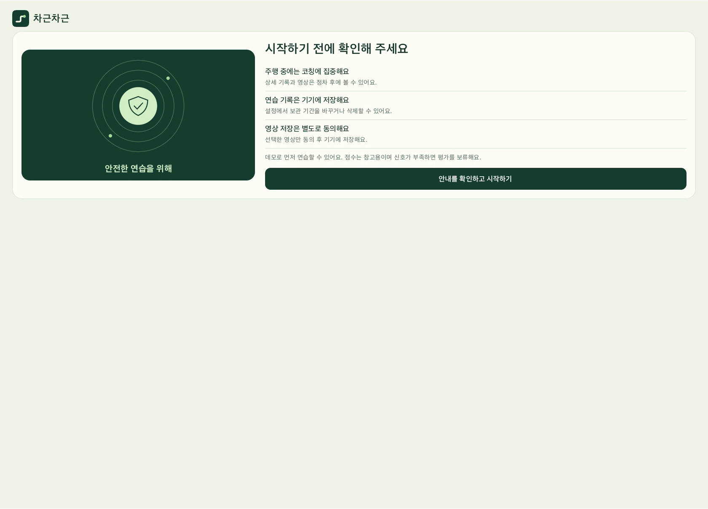 | 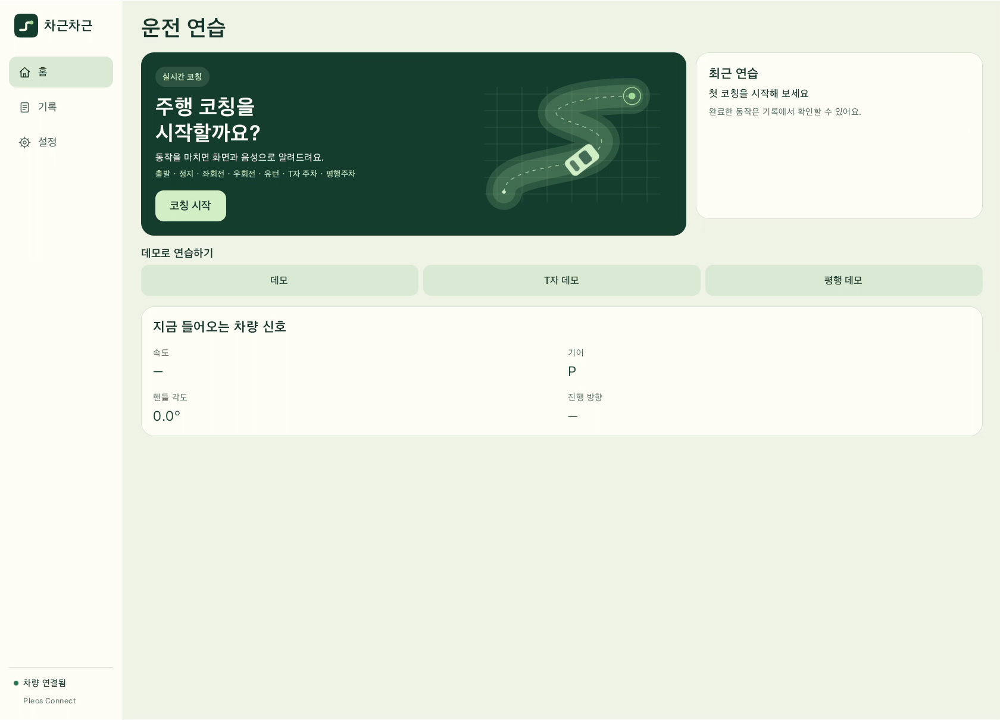 |

## 동작 완료 피드백

| 출발 · 100점 | T자 주차 · 90점 |
| --- | --- |
| 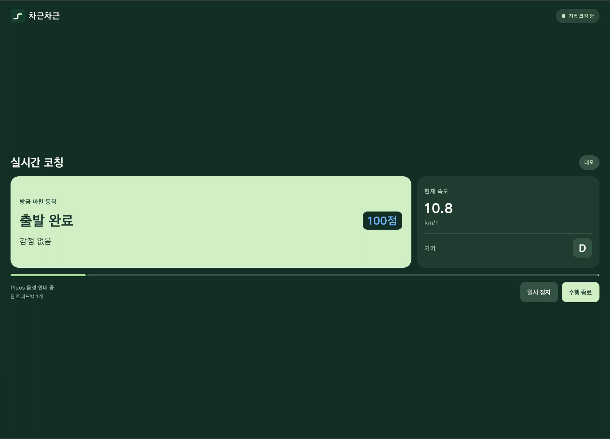 | 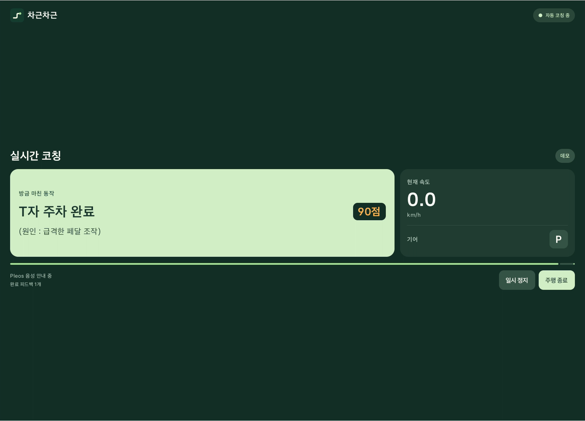 |

## T자 주차 기록과 궤적 복기

| 기록 상세·감점 이유 | 추정 궤적 재생 |
| --- | --- |
| 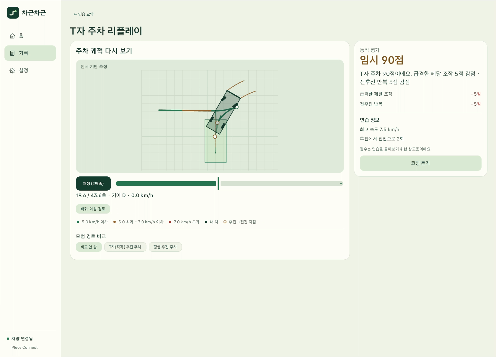 | 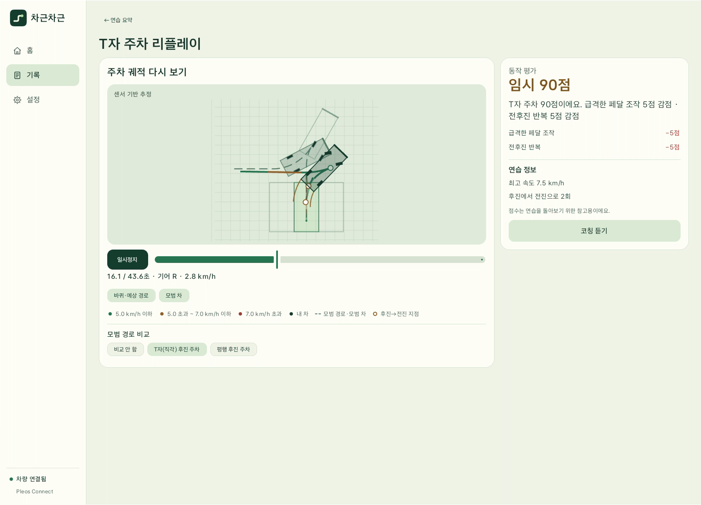 |

## 평행주차

| 완료 피드백 · 100점 | 추정 궤적 재생 |
| --- | --- |
| 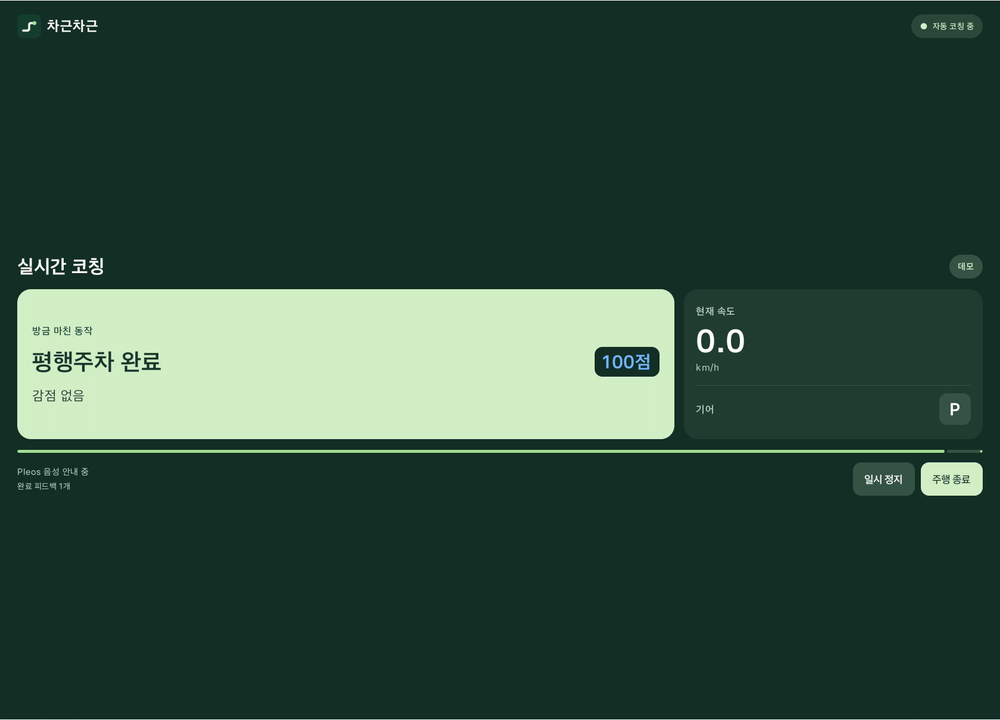 | 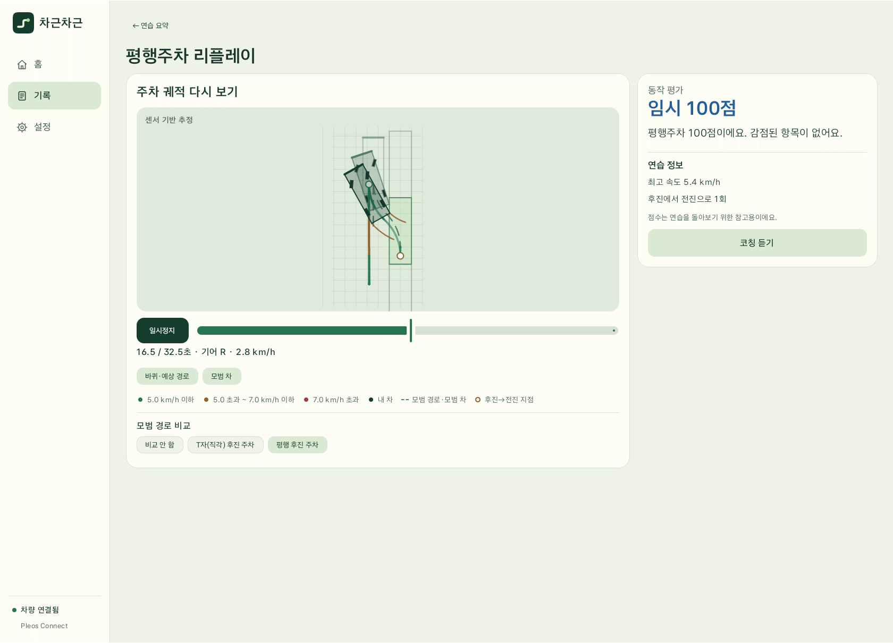 |

## 연습 요약과 저장 기록 질문

| 연습 요약 | 저장 기록·Gleo 연결 |
| --- | --- |
| 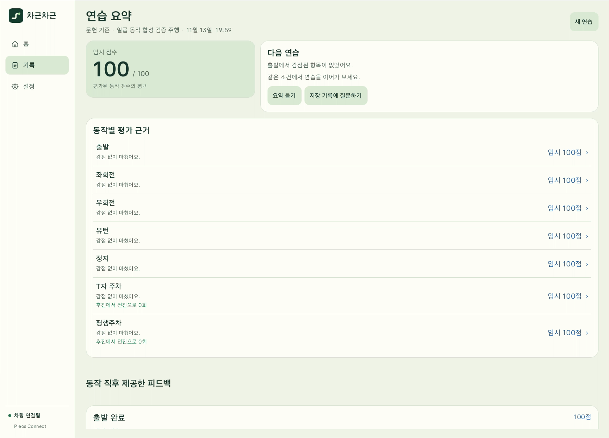 | 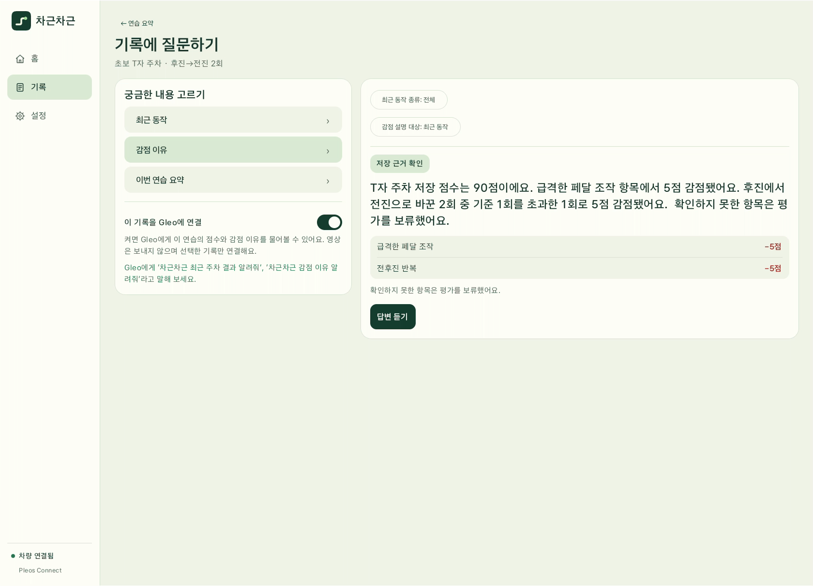 |

음성 질문과 실제 Gleo 답변은 [시연 영상의 05:03 이후](../media/README.md)에서 확인할 수 있습니다.

## 내비와 실제 분할 배치

P단·정차 상태에서 내비 옆에 앱을 배치한 화면입니다. 지도 주행이나 내비 경로 연동을 검증한 장면은 아닙니다.

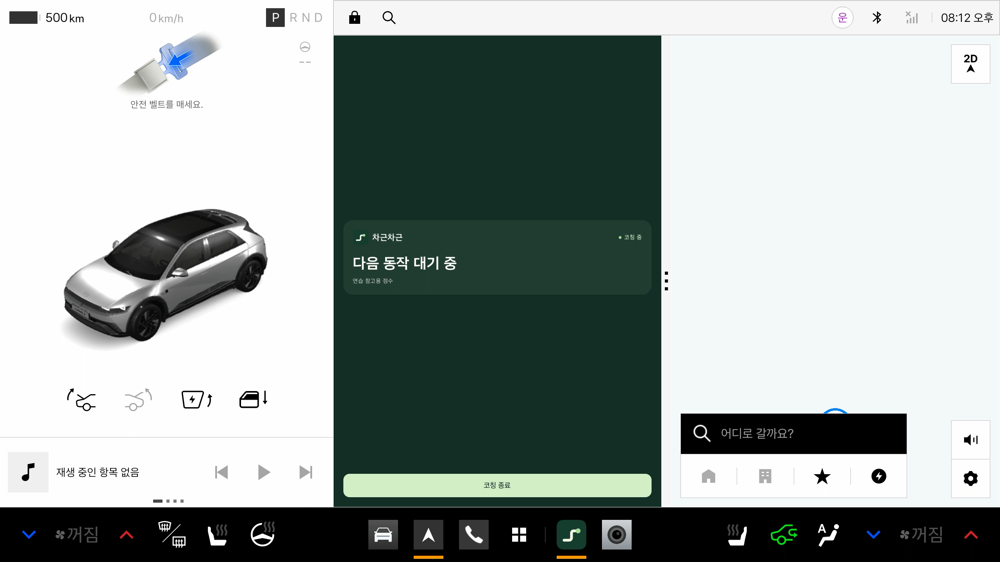

## 과거 화면 자료

README의 대표 화면은 모두 위 `0.13.3` 캡처로 갱신했습니다. `docs/validation/`과 `docs/screenshots/`의 버전별 화면은 해당 시점의 검사·저장 결과와 연결된 원본이므로 보존하며, 각 검증 문서의 이력 링크에서 확인할 수 있습니다. 현재 앱에서 제외한 주차 녹화·최종 배치 실험 화면도 현재 사용법과 구분합니다.
